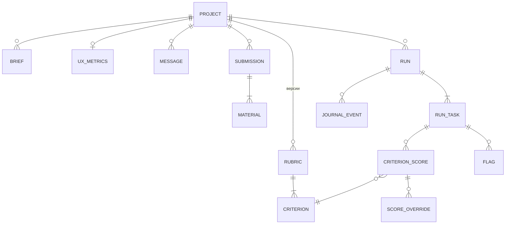

# Модель данных — AI-судья

Хранилище: SQLite на демо, затем Postgres (`PROJECT.md §2`); миграции — Alembic, SQL пишется без
диалектных расширений, чтобы переезд не менял схему. Идентификаторы — ULID (строка). Время — UTC.
Материалы-файлы лежат на томе (`contracts/agent-run.md` §1), в БД — только метаданные.

Общие правила (устав):
- **I-2:** мягкое удаление — колонка `deleted_at`; жёстко удаляется только содержимое файлов по сроку
  хранения (FR-031), запись остаётся с `status='deleted'`.
- **I-3:** `journal_event` и `score_override` — только INSERT; триггеры `BEFORE UPDATE/DELETE` кидают
  ошибку.
- **I-15:** у изменяемых сущностей колонка `version` (целое, +1 на каждую запись);
  `UPDATE … WHERE id=:id AND version=:expected`, ноль затронутых строк → 409.
- Списки журнала и сообщений — keyset по `(created_at, id)`; `OFFSET` не используется.

## Таблицы

### project
`id`, `name`, `type` (`product_hackathon|ml_hackathon|homework|other`), `status`
(`setup|intake|evaluating|results|archived`), `starts_on`, `ends_on`, `agents` (JSON-список ролей),
`required_materials` (JSON), `rubric_confirmed_version`, `retention_days` (по умолчанию 7),
`last_activity_at` (от него считается срок хранения), `version`, `created_at`, `updated_at`, `deleted_at`.

### brief
`id`, `project_id`, `name`, `source` (`upload|url|chat`), `status` (`processing|extracted|failed|deleted`),
`reason`, `path` (относительный), `extracted_text_path`, `created_at`, `deleted_at`.

### rubric / criterion
`rubric`: `id`, `project_id`, `version` (уникально в проекте), `status` (`draft|confirmed|superseded`),
`weights_were_missing`, `confirmed_at`, `created_at`. Версия иммутабельна после подтверждения.
`criterion`: `id`, `rubric_id`, `position`, `name`, `description`, `weight` (>0), `max_score` (>0),
`agent` (роль или `human`), `anchors` (JSON), `source_ref`. `criterion.id` у каждой версии рубрики свой
(первичный ключ строки); оценки хранят `criterion_id` и `rubric_version` как мягкую ссылку без внешнего
ключа (оценка остаётся при смене рубрики), существование критерия в версии проверяет service-слой
(`contracts/agent-run.md` §3). Сопоставление критериев между версиями — по `name` (FR-007).

### ux_metrics
`project_id` (PK), `metrics` (JSON), `created_at`. Один раз на проект, дальше только чтение (FR-017).

### message
`id`, `project_id`, `author`, `kind`, `text`, `attachments` (JSON), `created_at`. Ключ курсора —
`(created_at, id)`.

### submission
`id`, `project_id`, `team_name`, `intake_status` (`pending|running|ready|failed`), `completeness`,
`missing` (JSON), `inventory_path`, `version`, `created_at`, `deleted_at`. Уникально
`(project_id, team_name)`.

### material
`id`, `submission_id`, `type`, `source_kind` (`upload|url`), `source_ref`, `status`
(`available|partial|unavailable|deleted`), `reason`, `size_bytes`, `purged_at`.

### run
`id`, `project_id`, `rubric_version`, `status` (`queued|running|completed|partial|failed`),
`requested` (JSON: submission_ids, roles, criterion_ids), `tokens_in`, `tokens_out`, `cost_usd`
(NULL, если провайдер данных не дал), `created_at`, `finished_at`.

### run_task
`id`, `run_id`, `submission_id` (NULL для project-level ролей), `role`, `state`
(`queued|running|done|failed|no_data`), `attempt`, `reason`, `hermes_run_id`, `started_at`,
`finished_at`, `tokens_in`, `tokens_out`, `cost_usd`, `model`, `provider`.
Уникальный частичный индекс: одна активная задача на `(submission_id, role)` — состояния
`queued|running` (I-15). Для project-level задач (`submission_id` NULL: рубрика, метрики UX) индекс не
действует (NULL в уникальных индексах различны) — один активный запуск на проект гарантирует
оркестратор (T032).

### criterion_score
`id`, `run_task_id`, `submission_id`, `criterion_id`, `rubric_version`, `status` (`scored|no_data`),
`score`, `max_score`, `justification`, `evidence` (JSON), `confidence`, `no_data_reason`, `version`,
`created_at`. «Текущий» балл критерия для работы — последняя запись по `created_at` среди задач
последнего прогона, покрывавшего критерий; старые записи остаются (FR-024).

### score_override (append-only)
`id`, `criterion_score_id`, `submission_id`, `criterion_id`, `score`, `reason`, `actor`, `created_at`.
Текущая правка — последняя запись по `criterion_score_id`. `version` проверяется по числу записей
правок для этого балла.

### flag
`id`, `run_task_id`, `submission_id`, `criterion_id`, `type`, `confidence`, `note`, `evidence` (JSON),
`related_submission_id`, `related_url`, `created_at`. Флаги не меняют баллы (FR-023).

### journal_event (append-only)
Поля `contracts/journal-event.schema.json`, включая `schema_version` (по умолчанию `'1'`); первичный ключ
`(run_id, seq)`. На PostgreSQL защищён и от `TRUNCATE` (триггер на оператор). Уникально `(run_id, seq)`. Индексы: `(run_id, seq)` для
ленты, `(submission_id, seq)` для фильтра.

### claim
`id`, `run_task_id`, `claim_id`, `text`, `source_ref`, `verdict`, `evidence` (JSON) — утверждения
`critic-honesty` для модального окна команды.

## Вычисляемое

- **Итог работы** = `compute_score` по текущим баллам (с учётом правок), `no_data` и
  `human_pending` не входят в расчёт; `complete=false`, если остался критерий без значения (FR-021).
- **Ранг:** по итогу, равные итоги — одно место (FR-025).
- **Устаревшие оценки:** `criterion_score.rubric_version < rubric_confirmed_version` для критерия,
  изменившегося по смыслу, помечаются `stale` (FR-007).
